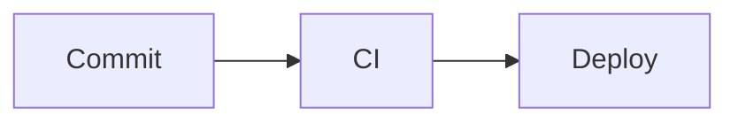

export const faq = [
  {
    q: "Is the preview the same as GitHub's?",
    a: "Very close: it uses GitHub Flavored Markdown (tables, task lists, strikethrough, autolinks) and the HTML is sanitized with similar rules, so raw scripts or event handlers are removed. Mermaid code blocks are drawn as diagrams, as GitHub does.",
  },
  {
    q: "How do I add a table of contents?",
    a: "Press TOC above the editor: it copies a nested list of links to every heading, with the same anchors GitHub generates. Paste it under your title.",
  },
  {
    q: "What does the HTML export contain?",
    a: "A standalone .html file with the rendered content, Mermaid diagrams as inline SVG and a small GitHub-like stylesheet, ready to open, print or attach.",
  },
];

## What does it do?

It is a **Markdown editor with a live preview** in GitHub style. Write on the left and see the result on the right: headings, **tables**, **task lists**, **code blocks with syntax highlighting** and **Mermaid diagrams** embedded in fenced blocks.

It is made for writing **READMEs, pull request descriptions, changelogs and docs** before publishing them.

## Mermaid diagrams

Fence a block with the `mermaid` language and it is drawn as a diagram:

````md

````

## Quick reference

| Markdown | Result |
| --- | --- |
| `**bold**` | **bold** |
| `[link](https://…)` | a link |
| `- [x] done` | a checked task |
| `> note` | a quote |
| three backticks + language | highlighted code |
