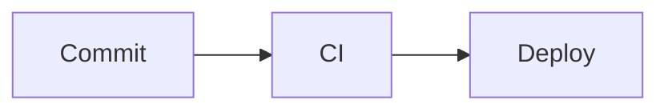

export const faq = [
  {
    q: "¿La vista previa es igual que la de GitHub?",
    a: "Muy parecida: usa GitHub Flavored Markdown (tablas, listas de tareas, tachado, enlaces automáticos) y el HTML se sanea con reglas similares, así que se eliminan scripts o manejadores de eventos. Los bloques de código Mermaid se dibujan como diagramas, igual que en GitHub.",
  },
  {
    q: "¿Cómo añado un índice?",
    a: "Pulsa Índice encima del editor: copia una lista anidada de enlaces a cada encabezado, con las mismas anclas que genera GitHub. Pégala bajo tu título.",
  },
  {
    q: "¿Qué contiene la exportación a HTML?",
    a: "Un fichero .html independiente con el contenido renderizado, los diagramas Mermaid como SVG en línea y una pequeña hoja de estilos parecida a la de GitHub, listo para abrir, imprimir o adjuntar.",
  },
];

## ¿Qué hace?

Es un **editor de Markdown con vista previa en vivo** al estilo de GitHub. Escribe a la izquierda y mira el resultado a la derecha: encabezados, **tablas**, **listas de tareas**, **bloques de código con resaltado de sintaxis** y **diagramas Mermaid** dentro de bloques de código.

Está pensado para escribir **README, descripciones de pull requests, changelogs y documentación** antes de publicarlos.

## Diagramas Mermaid

Marca un bloque con el lenguaje `mermaid` y se dibuja como diagrama:

````md

````

## Referencia rápida

| Markdown | Resultado |
| --- | --- |
| `**negrita**` | **negrita** |
| `[enlace](https://…)` | un enlace |
| `- [x] hecho` | una tarea marcada |
| `> nota` | una cita |
| tres comillas invertidas + lenguaje | código resaltado |
