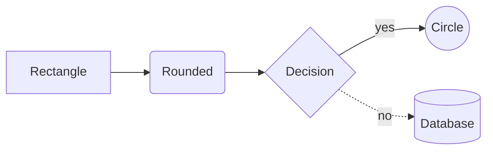

export const faq = [
  {
    q: "Is my diagram uploaded anywhere?",
    a: "No. Mermaid renders the diagram in your browser. When you share a link, the diagram is compressed into the part of the URL after the #, which browsers never send to the server.",
  },
  {
    q: "Can I use these diagrams in GitHub?",
    a: "Yes. GitHub, GitLab and many documentation tools render Mermaid natively. Put the code inside a fenced code block with the mermaid language in your README or pull request description.",
  },
  {
    q: "How do I export the diagram?",
    a: "Use the SVG button for a vector file that stays sharp at any size, or PNG for a high-resolution image (rendered at 2x) to paste in slides or chats.",
  },
  {
    q: "Why does the preview show an error?",
    a: "Mermaid syntax is strict about indentation, arrows and keywords. The error message tells you the line where parsing failed; the last valid diagram stays visible, faded, until you fix it.",
  },
];

## What is Mermaid?

[Mermaid](https://mermaid.js.org) is a text syntax for diagrams. Instead of dragging boxes around, you write `A --> B` and get a flowchart. Because diagrams are plain text, they live next to your code, can be reviewed in pull requests and never go out of date in a forgotten drawing file.

## How to use this editor

1. Write or paste Mermaid code on the left, or pick a **template**: flowchart, sequence, class, state, entity relationship, Gantt, pie or mind map.
2. The diagram updates on the right as you type. Errors are shown above the preview.
3. Zoom with the buttons or with **Ctrl + mouse wheel**.
4. Export to **SVG** or **PNG**, or click **Share** to copy a link that contains the whole diagram.

## Quick syntax reference

- `flowchart TD` goes top-down, `LR` goes left to right.
- `-->` is an arrow, `-.->` a dotted arrow, `==>` a thick one, and `-->|text|` adds a label.
- In sequence diagrams, `->>` is a request and `-->>` a response.
- Lines starting with `%%` are comments.
