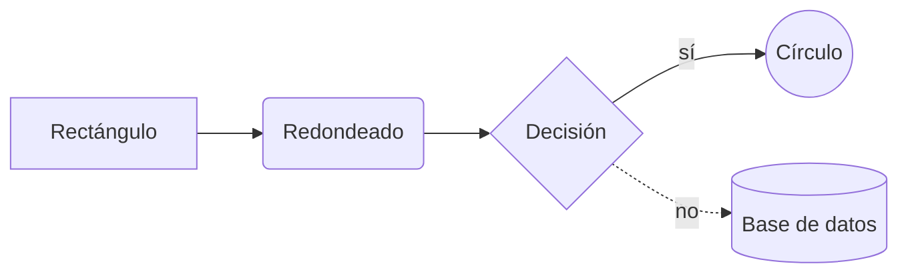

export const faq = [
  {
    q: "¿Mi diagrama se sube a algún sitio?",
    a: "No. Mermaid dibuja el diagrama en tu navegador. Cuando compartes un enlace, el diagrama se comprime en la parte de la URL que va después de la #, que los navegadores nunca envían al servidor.",
  },
  {
    q: "¿Puedo usar estos diagramas en GitHub?",
    a: "Sí. GitHub, GitLab y muchas herramientas de documentación muestran Mermaid de forma nativa. Pon el código dentro de un bloque de código con el lenguaje mermaid en tu README o en la descripción de la pull request.",
  },
  {
    q: "¿Cómo exporto el diagrama?",
    a: "Usa el botón SVG para un archivo vectorial que se ve nítido a cualquier tamaño, o PNG para una imagen de alta resolución (a 2x) que pegar en presentaciones o chats.",
  },
  {
    q: "¿Por qué la vista previa muestra un error?",
    a: "La sintaxis de Mermaid es estricta con la indentación, las flechas y las palabras clave. El mensaje indica la línea en la que falló el análisis; el último diagrama válido se queda visible, atenuado, hasta que lo arregles.",
  },
];

## ¿Qué es Mermaid?

[Mermaid](https://mermaid.js.org) es una sintaxis de texto para diagramas. En lugar de arrastrar cajas, escribes `A --> B` y obtienes un diagrama de flujo. Como los diagramas son texto plano, viven junto a tu código, se pueden revisar en las pull requests y nunca se quedan desactualizados en un archivo de dibujo olvidado.

## Cómo usar este editor

1. Escribe o pega código Mermaid a la izquierda, o elige una **plantilla**: diagrama de flujo, de secuencia, de clases, de estados, entidad-relación, Gantt, gráfico circular o mapa mental.
2. El diagrama se actualiza a la derecha mientras escribes. Los errores aparecen encima de la vista previa.
3. Haz zoom con los botones o con **Ctrl + rueda del ratón**.
4. Exporta a **SVG** o **PNG**, o pulsa **Compartir** para copiar un enlace que contiene el diagrama completo.

## Chuleta rápida de sintaxis

- `flowchart TD` va de arriba abajo; `LR`, de izquierda a derecha.
- `-->` es una flecha, `-.->` una flecha punteada, `==>` una gruesa, y `-->|texto|` añade una etiqueta.
- En los diagramas de secuencia, `->>` es una petición y `-->>` una respuesta.
- Las líneas que empiezan por `%%` son comentarios.
